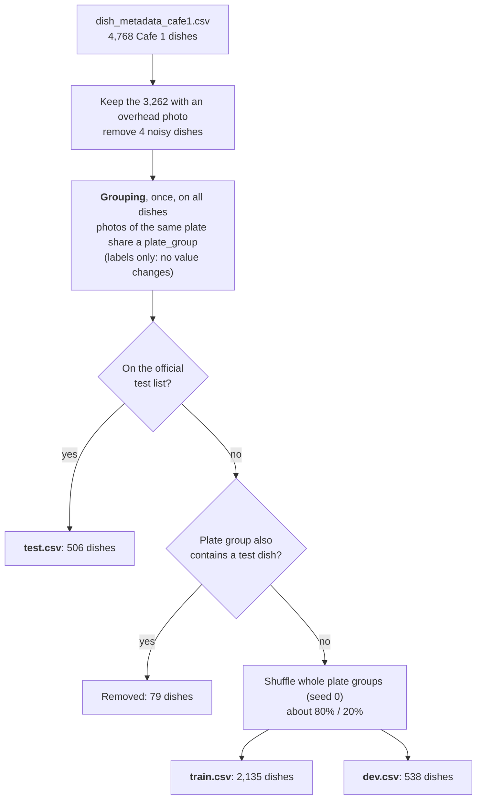

# Split files

Which dishes are used for training, development and the final test. Everyone on the team uses these same files.

| File | Dishes | Plates | Use |
|---|---|---|---|
| `train.csv` | 2,135 | 746 | The model learns from these. |
| `dev.csv` | 538 | 182 | Check progress and choose settings (for example, when to stop training). |
| `test.csv` | 506 | 204 | Final results only, used once at the end. Do not tune on these. |

## How the files are built

**Goal:** no plate is trained on and then evaluated. Nutrition5k often photographed one plate several times as food was added; each photo is its own dish with its own labels, but later photos contain the same food. Plate groups only decide which file a dish goes into. The model trains on each dish individually.

### 1. Dishes
Cafe 1 dishes with an overhead photo (3,262), as in the Nutrition5k paper. Removed as noisy data:
- 2 dishes with 0 kcal (one is an empty plate);
- 1 dish listed as 3,051 g and 3,943 kcal (small amounts of spinach, chips and corn);
- 1 dish whose photo shows a phone, not food (`dish_1559172356`).

### 2. Plate groups
Nutrition5k does not record which photos share a plate, so two methods infer it. Two dishes are the same plate if **either** method links them.

- **A. Ingredient rule.** A dish is linked to the dish recorded right before it if they are at most 120 seconds apart, every ingredient of the earlier dish is in the later one with at least the same weight, and the total mass does not drop (tolerance for both: 5% or 1 g). Ingredient weights come from a scale, so different plates rarely match.
- **B. calorie-lens groups.** The `group` column of the [calorie-lens dataset](https://huggingface.co/datasets/shalev396/calorie-lens-data) (a cleaned Nutrition5k, Creative Commons Attribution 4.0).

The methods miss opposite links, so we use both:

| Time between photos | Found by both | Only by A | Only by B |
|---|---|---|---|
| up to 2 minutes | 2,392 | 261 | 13 |
| over 2 minutes | 0 | 0 | 153 |

A missed link can leak a plate across files; a wrong link only removes or moves a few photos. Groups have 1–12 photos. `plate_links.csv` lists every link and which method found it.

### 3. Splits
- **Test:** the official Nutrition5k test list, used as given (507 minus 1 noisy dish = 506).
- **Training and development:** the official training list (2,755 dishes with photos), minus 3 noisy dishes and 79 dishes that share a plate with a test dish, leaves 2,673. Whole plate groups are shuffled (seed 0) and added to development until it reaches 20% (535); the last group takes it to 538. The rest (2,135) are training.

The script stops with an error if any dish or plate group appears in two files.

**Limitation:** grouping is inferred and can still miss repeat photos. The photo review found one: identical carrot photos 331 seconds apart (pair 18 in the review page), both in training, so no leak.

## Columns

| Column | Meaning |
|---|---|
| `dish_id` | Nutrition5k dish number; also the photo folder name |
| `split` | `train`, `dev` or `test` |
| `plate_group` | Physical plate the photo belongs to |
| `image_path` | Photo path inside the Nutrition5k folder |
| `mass_g`, `energy_kcal`, `protein_g`, `carbohydrate_g`, `fat_g` | Labels (grams; energy in kcal) |
| `n_ingredients` | Number of ingredients |
| `energy_mismatch_flag` | `1` if the energy and the energy estimated from the nutrients differ by over 30% (below) |
| `deprecated_ingredient_flag` | `1` if the dish contains an ingredient named "deprecated" |

## Flagged but kept

- **Energy mismatch (116 dishes: 83 training, 26 development, 7 test).** Energy is estimated as 9 × fat + 4 × carbohydrate + 4 × protein (standard Atwater factors; Nutrition5k's ingredient table agrees, e.g. olive oil 8.84 and sugar 3.88 kcal per gram). A typical dish is within 4% of its listed energy; a dish is flagged if the difference is over 30% of the listed energy, in either direction. Example: a fish dish lists 35.1 kcal but its nutrients give 74.7 kcal (113% off). Most flagged dishes contain "fish", which suggests noisy fat values. Fatty dishes are not flagged for being fatty (2 of 86 pizza dishes are flagged).
- **"Deprecated" ingredient (30 dishes: 19 training, 3 development, 8 test).** An outdated entry in Nutrition5k's ingredient table, so labels may be noisy.

No dish has both flags.

## Other files

| File | Contents |
|---|---|
| `dropped.csv` | Every removed dish and why |
| `plate_links.csv` | Every same-plate link, the method that found it (`found_by`), and its evidence |
| `plate_pair_review.html` | Photo pairs side by side for checking grouping by eye; shows whether the combined grouping links each pair (open in a browser; photos load online) |
| `summary.json` | Counts, settings and file fingerprints (hashes) |

## Rebuild

Needs the Nutrition5k metadata (no photos) and the calorie-lens `dishes.parquet` (403 KB):

1. Download https://huggingface.co/datasets/shalev396/calorie-lens-data/resolve/main/dishes.parquet to a `calorie-lens` folder next to your `nutrition5k` folder.
2. Run `python src/build_splits.py --data-root <nutrition5k folder> --extra-groups <dishes.parquet>`. Needs `pandas` and `pyarrow`.

The same inputs give identical files. `python src/html_plate_review.py` rebuilds the review page.
