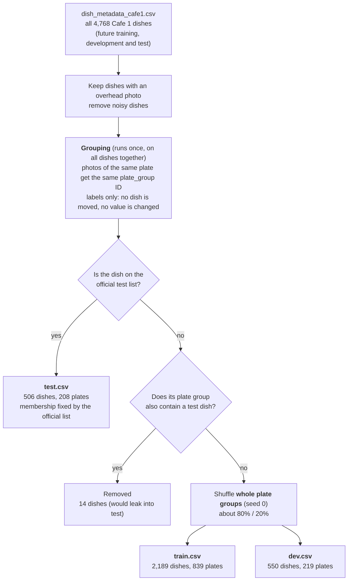

# Split files

These files decide **which dishes are used for training, which for development, and which for the final test**. Everyone on the team should use these same files so our results are consistent and can be compared fairly.

## The three splits

| File | Number of dishes | What it is used for |
|---|---|---|
| `train.csv` | 2,189 | The model learns from these dishes. |
| `dev.csv` | 550 | We check progress and tune settings on these (for example, when to stop training). |
| `test.csv` | 506 | Used **only once, at the end**, for the final reported results. Do not tune anything on these. |

## Plate groups and splits in short

**Goal:** the model is never trained on a plate and then evaluated on the same plate, in either development or test.

Nutrition5k often photographed one plate several times as food was added. Each photo is a separate dish with its own nutrient values, but later photos contain the same food as earlier ones. A **plate group** is the set of photos of one physical plate.

### How the files are built



### Example

| Plate group | Dishes | On official test list? | Result |
|---|---|---|---|
| Group 5 | `dish_A`, `dish_B` | `dish_A` yes, `dish_B` no | `dish_A` → test. `dish_B` removed: it shares food with a test photo. |
| Group 6 | `dish_C`, `dish_D` | No | Both → development (the group moves as a unit). |
| Group 7 | `dish_E`, `dish_F`, `dish_G` | No | All → training (the group moves as a unit). |

Every dish keeps its own nutrient values, and the model trains on each dish in `train.csv` individually. Plate groups only decide which file a dish goes into.

### What protects what

| Protection | Comes from | Checked by |
|---|---|---|
| Test membership does not change | The official list of test dish IDs | Comparing `test.csv` with the official list: all 506 dishes are on it; the 1 missing official dish is a removed noisy dish |
| No plate shared between training and test | Grouping, then removing training dishes that share a test plate | The script stops with an error if any dish or plate group appears in two files |
| No plate shared between training and development | Assigning whole plate groups | Same check |
| The grouping rule itself finds every real repeat photo | The rules in Step 3 | Not checkable from the files: needs a visual review of photo pairs (see "Manual check" in Step 3) |

Plate groups are also used for plate-level confidence intervals in the final evaluation. They are not used during training.

## What is in each file

Each row is one dish. The columns are:

| Column | Meaning | Example |
|---|---|---|
| `dish_id` | The Nutrition5k dish number. It is also the name of the dish's photo folder. | `dish_1556572657` |
| `split` | Which split the dish is in: `train`, `dev` or `test`. | `train` |
| `plate_group` | Which physical plate the photo belongs to (see Step 3 below). | `group_01039` |
| `image_path` | Where the overhead photo is, starting from the Nutrition5k folder. | `imagery/realsense_overhead/dish_1556572657/rgb.png` |
| `mass_g` | Total food weight, in grams. | `36.0` |
| `energy_kcal` | Total energy, in kilocalories. | `41.4` |
| `protein_g` | Protein, in grams. | `0.288` |
| `carbohydrate_g` | Carbohydrate, in grams. | `2.268` |
| `fat_g` | Fat, in grams. | `3.852` |
| `n_ingredients` | How many ingredients the dish has. | `1` |
| `energy_mismatch_flag` | `1` if the energy does not add up from the fat, carbohydrate and protein (see "Dishes we kept but marked" below). Otherwise `0`. | `0` |
| `deprecated_ingredient_flag` | `1` if the dish contains an ingredient named "deprecated" (see "Dishes we kept but marked" below). Otherwise `0`. | `0` |

## How the files were made

### Step 1: Start with dishes that have an overhead photo
Nutrition5k has 4,768 dishes from its first cafeteria ("Cafe 1"). Only **3,262** of them have an overhead photo, so we use those. We leave out the second cafeteria, as the original Nutrition5k paper did.

### Step 2: Remove noisy data
We removed 3 dishes with noisy labels:
- 2 dishes listed as **0 kilocalories**, one of them an empty plate.
- 1 dish listed as **3,051 grams and 3,943 kilocalories**, although its ingredients are small amounts of spinach, chips and corn.

### Step 3: Keep repeat photos of the same plate together
Nutrition5k often photographed one plate several times as food was added, and each photo got its own dish number. To avoid leakage between splits, we gave every plate a `plate_group` and kept each group in a single file. Grouping runs once over all 4,768 Cafe 1 dishes, before splitting, so plates that span the official training and test lists can be detected.

Nutrition5k does not label which photos share a plate, so we infer it. Two dishes count as the **same plate** when **all** of these are true:
- they were recorded one right after the other, **no more than 120 seconds apart** (the dish number is the recording time in seconds);
- **every ingredient of the earlier dish is in the later dish with at least the same weight** (tolerance: 5% or 1 gram, whichever is larger);
- the later dish's **total mass did not drop** by more than 5% or 1 gram, whichever is larger.

The ingredient-weight condition is the main evidence. Ingredient weights were measured on a scale, so two different plates are very unlikely to match ingredient by ingredient. Where a shared ingredient's weight does increase, it is usually oil, salt, pepper or vinegar from a dressing added in the later step.

The rule covers two cases: food added to the plate, and the same plate photographed again with nothing added. A plate has between 1 and 9 photos.

**How the 120-second cutoff was chosen.** We looked at all consecutive dish pairs that pass the weight condition, with no time limit (2,706 pairs):

| Time between photos | Pairs |
|---|---|
| 0–30 seconds | 964 |
| 30–60 seconds | 1,479 |
| 60–90 seconds | 176 |
| 90–120 seconds | 36 |
| 120–600 seconds | 48 |
| over 600 seconds | 3 |

98% of these pairs are within 120 seconds. Beyond that, the evidence is weaker: about half of the 120–600 second pairs start from a single-ingredient dish (for example, one portion of berries), which could be matched by a different plate. Moving the cutoff between 120 and 600 seconds changes the result very little: 47 links and 6 training dishes that share a plate with a test dish.

**How the mass tolerance was chosen.** Among pairs that pass the weight condition, total mass sometimes drops slightly, by up to 3%, which is likely scale noise. A 5% tolerance allows this. Two pairs where mass dropped by about 97% are rejected.

**Rules we tested and rejected:**
- *Ingredient names only, no weight check.* This linked pairs where a portion got smaller (for example, mandarin oranges 99 g → 52 g), which are likely different plates. It also missed 277 re-photographs of an identical plate.
- *Also comparing with the 3 dishes recorded before, not just the previous one.* This merged plates into groups of up to 16 photos, mostly through common single items such as "berries". We judged most of those to be false links.
- *A 10-minute cutoff.* Accepts the weaker long-gap links described above.

**Manual check.** Open [plate_pair_review.html](plate_pair_review.html) in a browser (internet needed; photos load from Nutrition5k's public storage). It shows 22 photo pairs side by side: linked pairs near the time cutoff, unlinked pairs just beyond it, and the two identical-label pairs below. Rebuild it with `python src/html_plate_review.py --data-root <path to your nutrition5k folder>`. `plate_links.csv` lists every link with its evidence (time gap, mass change, identical ingredients) for further checks.

Also check these two cross-split pairs. They have identical labels and were recorded about 20 minutes apart, beyond the 120-second cutoff, so they could be one plate photographed again after a break:
- `dish_1559242066` (development) and `dish_1559243139` (training): carrots with oil, salt and pepper, 1,073 seconds apart;
- `dish_1562689601` (training) and `dish_1562690886` (test): broccoli with olive oil, 1,285 seconds apart.

Other dishes with identical labels across splits (88 sets) are mostly single-ingredient servings of the same weight recorded hours to weeks apart, such as 28 g of bacon. Nutrition5k computes nutrients as weight × per-gram value, so these are separate servings, not the same plate.

**Limitation:** this is an inferred grouping. A plate whose photos were not recorded consecutively, or more than 120 seconds apart, would be split into separate groups.

### Step 4: Split into training, development and test
- **Test** is Nutrition5k's own official test list, used as given, so our final results can be compared with other work. Grouping only adds `plate_group` labels to test dishes.
- **Training and development** come from Nutrition5k's official training list. We shuffled the **plates** (not the individual photos) and put about 80% in training and 20% in development. The shuffle uses a fixed seed (0), so running the script again gives exactly the same files.
- **14 training dishes** were the same plate as a test dish, so we removed them. Most were re-photographs of an identical plate. Nutrition5k's official split is not separated by plate: before this step, 14 plate groups had photos on both the official training list and the official test list. Test dishes were kept because test is the official list; the training photos of those plates were removed. After this step, no plate group appears in more than one file.
- **Known remaining leak:** the rule can miss a link, giving one physical plate two group IDs. The photo review found one such plate across test and training: an apple photographed twice 282 seconds apart (`dish_1558717604` in test, `dish_1558717886` in training), beyond the 120-second cutoff. The cutoff is under review; a 600-second cutoff would link this pair and about 5 similar ones.

**Where the numbers come from:** test is the official list (507) minus 1 noisy dish = 506. The official training list has 2,755 dishes with overhead photos; removing 2 noisy dishes and the 14 above leaves 2,739. Whole plates are added to development until it reaches 20% of 2,739 (548 dishes); the last plate added takes it to 550. The rest (2,189) go to training. The 80/20 ratio matches the proposal's plan of about 640 training and 160 development records.

The script checks that **no dish and no plate appears in more than one file**.

## Dishes we kept but marked

For **116 dishes**, the listed energy differs by more than 30% from 9 × fat + 4 × carbohydrate + 4 × protein. Most contain "fish", which points to noise in Nutrition5k's ingredient table rather than in the photos.

We kept these dishes and set `energy_mismatch_flag` to `1`, so their effect on results can be tested later.

**31 dishes** contain an ingredient named "deprecated" (18 training, 5 development, 8 test), an outdated entry in Nutrition5k's ingredient table, so their labels may be noisy. We kept them and set `deprecated_ingredient_flag` to `1`. No dish has both flags.

## Other files in this folder

| File | What it contains |
|---|---|
| `dropped.csv` | Every removed dish and the reason. |
| `plate_links.csv` | Every inferred same-plate link with its evidence, for manual checking. |
| `plate_pair_review.html` | Side-by-side photo pairs for checking the grouping rule by eye. |
| `summary.json` | All counts, the settings used, and a fingerprint (hash) of each split file to confirm everyone has the same version. |

## How to rebuild these files

You only need the Nutrition5k metadata (the spreadsheets and ID lists), not the photos:

```
python src/build_splits.py --data-root <path to your nutrition5k folder>
```

The Nutrition5k folder must contain `metadata/`, `dish_ids/` and `overhead_dirs.txt`. Running it again with the same data gives identical files.
