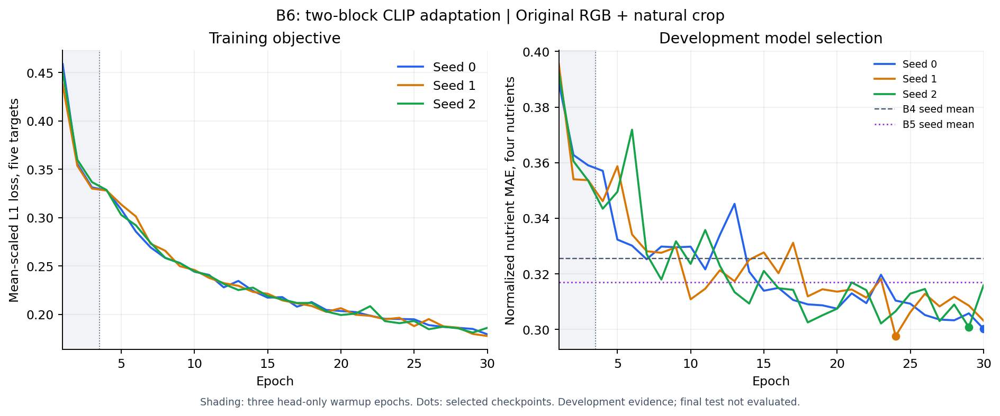

# 008 - Two-block CLIP adaptation (B6)

Status: Completed on November 22, 2026 (America/Chicago). B7-B10 were not started.

B6 adds visual block 10 to B5's trainable block 11, post-LN and projection.
The original image and the same natural crop share one CLIP ViT-B/32 visual
encoder. The SAM front end and crop definition remain fixed. B6 reached
**0.2996 +/- 0.0017 development normalized nutrient MAE** across all three
seeds. All six paired plate-group intervals favored B6 over the retained B4
and supplied B5 models. Final-test images/labels were not evaluated.

## Measured development results

Lower is better. Uncertainty in this table is sample SD across three seeds.

| Condition | Visual adaptation | Normalized nutrient MAE |
| --- | --- | ---: |
| B4 | Frozen CLIP; original + natural crop | 0.3255 +/- 0.0020 |
| B5 (supplied baseline) | Last visual block | 0.3169 +/- 0.0048 |
| B6 | Last two visual blocks | **0.2996 +/- 0.0017** |

| B6 seed | Selected epoch | Normalized nutrient MAE |
| --- | ---: | ---: |
| 0 | 30 | 0.3003 |
| 1 | 24 | 0.2976 |
| 2 | 29 | 0.3008 |

All five target MAEs also decreased in every seed-matched comparison. The
following values average the per-target MAE across seeds; mass is reported
separately and does not enter the four-nutrient primary metric.

| Target / unit | B4 | B5 | B6 |
| --- | ---: | ---: | ---: |
| mass_g | 45.125 | 41.912 | 39.839 |
| energy_kcal | 65.468 | 65.448 | 60.399 |
| protein_g | 6.024 | 5.820 | 5.441 |
| carbohydrate_g | 6.271 | 5.989 | 5.795 |
| fat_g | 4.992 | 4.883 | 4.643 |

## Paired uncertainty

Same 538 dev dishes, 182 inferred plate groups, 1000 bootstrap draws, RNG seed 0.
Negative candidate-minus-baseline values favor B6. These intervals describe the
development comparison, not independent final-test generalization.

| Comparison | Seed | MAE delta | Paired 95% interval |
| --- | ---: | ---: | --- |
| B6 - B4 | 0 | -0.02517 | [-0.03805, -0.01237] |
| B6 - B4 | 1 | -0.02985 | [-0.04135, -0.01881] |
| B6 - B4 | 2 | -0.02274 | [-0.03443, -0.01153] |
| B6 - B5 | 0 | -0.01595 | [-0.02643, -0.00676] |
| B6 - B5 | 1 | -0.01490 | [-0.02606, -0.00445] |
| B6 - B5 | 2 | -0.02114 | [-0.03192, -0.01143] |

See [comparison.json](comparison.json) for full precision and per-target deltas.
The initial B4-only comparison remains in
[comparison-initial-B4.json](comparison-initial-B4.json). B5 arrived during B6
training, so its full comparison was completed afterward without retraining B6
or rewriting the original execution status.

## Frozen setup and provenance

- Canonical 2135 train / 538 dev, with split hashes in [protocol.json](protocol.json).
- Official OpenAI CLIP ViT-B/32 weights, SHA256
  `40d365715913c9da98579312b702a82c18be219cc2a73407c4526f58eba950af`.
- One shared visual encoder; 14,570,496 selected visual parameters and a
  66,309-parameter dual-view head. Other visual parameters and text tower frozen.
- Head LR 1e-3, selected CLIP LR 1e-5, AdamW weight decay 1e-3, dropout 0.5.
- Physical batch 8, accumulation 4, 30 epochs, three head-only warmup epochs,
  seeds 0/1/2, FP16 autocast plus gradient scaling; no new augmentation.
- Train-only per-view feature mean/std and target means; L1 on five scaled
  targets. Select the lowest dev four-nutrient normalized MAE epoch per seed.
- Protocol committed at `35a6fb2`; implementation at `e12d4ff`; input restoration
  at `8cabfe1`; clean measured execution at
  `b45165e6824513989a65cad6edab3deb210ff9fc`.
- All 2673 original/crop pairs match the handoff byte hashes. Public RGBs and
  the already-acquired predicted crop boxes restored those same files; no new
  SAM inference, human masks or test data were used in this preparation.
- B5 was supplied by the teammate, not trained in this task. Its reported code
  commit matches the frozen B5 implementation; all three predictions, canonical
  labels/IDs, feature hashes and 90 training-log rows were verified. See
  [B5 handoff check](baselines/b5-handoff-check.json).

B5/B4 were run in Colab, while B6 used a different server environment: Python
3.9.25 / PyTorch 2.8.0+cu128 versus Python 3.13.16 / PyTorch 2.14.1+cu130 in the
supplied B5 result. OpenCLIP stayed at 2.24.0, and image/feature inputs match.
The measured comparison supports the B6 configuration on this dev cohort;
**it does not isolate the effect of the extra block from every runtime
difference**. The dev data was used for checkpoint selection. No final-test
claim or production-model replacement is made.

## Evidence and reproduction

- [Run record](run-records/B6.md), [environment](environment.json),
  [contribution-guide assessment](CONTRIBUTING_REVIEW.md).
- [Metrics](results/B6/metrics.json), [90-row training log](results/B6/training_log.csv),
  and three ID-keyed development prediction CSVs in `results/B6/`.
- [Independent numeric verification](verification.json),
  [full input check](data-preflight.json), and [preflight evidence](preflight/).
- [Artifact manifest](artifact-manifest.json): checkpoints remain on the
  team-designated server under `$B6_RUN_ROOT/results/B6/checkpoints/`.
  Obtain approved access from the project owner and verify the listed hashes.
  Images, feature arrays, original/crop metadata and base CLIP weights also
  remain outside Git; their hashes are recorded in the manifest/protocol.

Run the guarded workflow from the repository root with a new output directory:

```bash
CUDA_VISIBLE_DEVICES=0 PYTHONDONTWRITEBYTECODE=1 "$B6_ENV/bin/python" -u -B \
  B_nutrition_estimation/run_b6_pipeline.py \
  --input-root "$SOURCE_ROOT" --clip-cache "$CLIP_CACHE" \
  --run-root "$B6_RUN_ROOT" \
  --b5-results "$B5_RESULTS"
```

`SOURCE_ROOT` contains `images/`, `crops/`, `clip_original.npz`, `clip_crop.npz`,
`downloads.json` and `crop_metadata.json`. Use the exact environment versions
recorded above; the Python 3.9 server environment is an explicit difference from
the handoff's preferred Python 3.11+ setup. The runner verifies inputs, executes
unit tests and a separate one-epoch smoke check, trains B6 and compares it.
It never launches B7-B10. The original run received B5 later; its two exact
comparison stages are recorded in the run record.

CPU-only numeric recheck (no checkpoint loading or neural inference):

```bash
PYTHONDONTWRITEBYTECODE=1 python experiments/008-b-two-block-clip/verify_report.py \
  --project . --results experiments/008-b-two-block-clip/results/B6 \
  --environment experiments/008-b-two-block-clip/environment.json \
  --comparison experiments/008-b-two-block-clip/comparison.json \
  --b5 experiments/008-b-two-block-clip/baselines/B5 \
  --output /tmp/b6-verification.json
```



Model training plus dev evaluation took 27.1 minutes
on GPU 0; GPU 1 was not used. The complete guarded run, including smoke and
comparisons but excluding data/software preparation, took about 28.4 minutes.
These timings are not a hardware-matched speed comparison with Colab.
Teammate review remains pending; no PR merge was performed. Work stops at B6.
